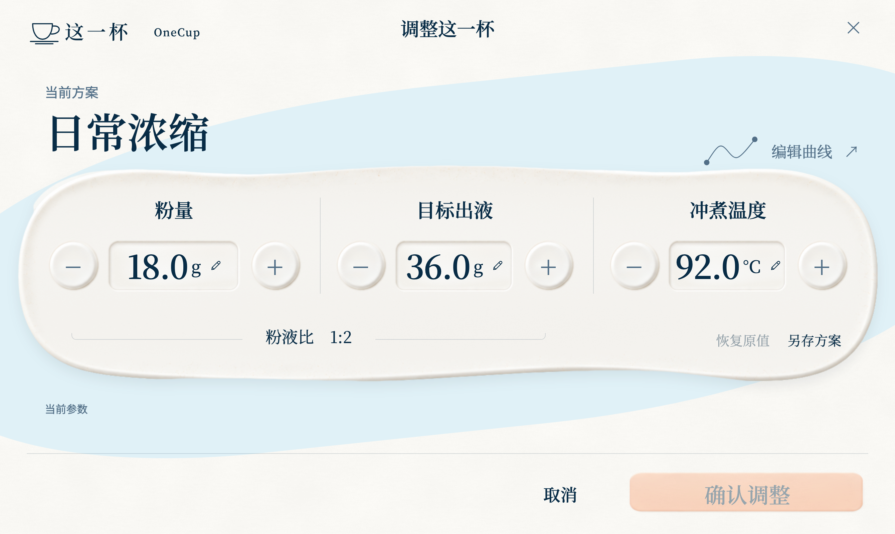
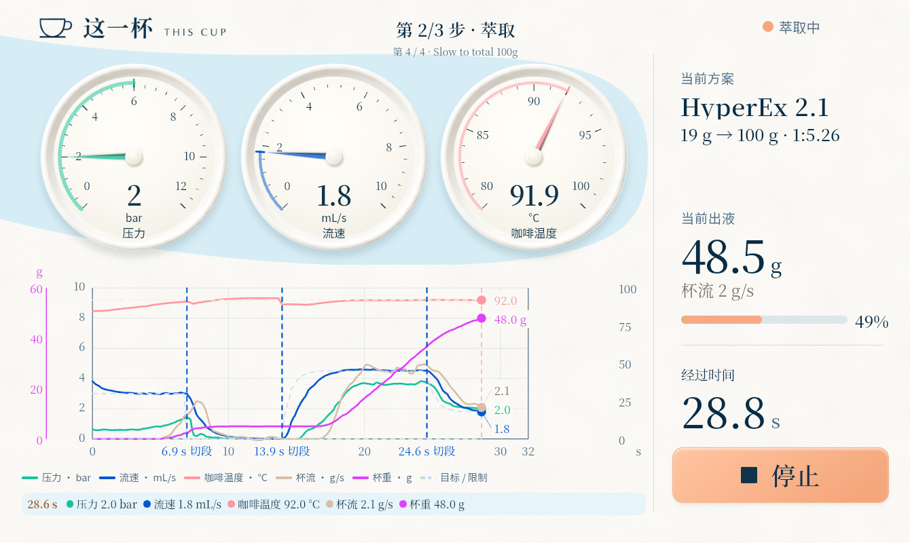
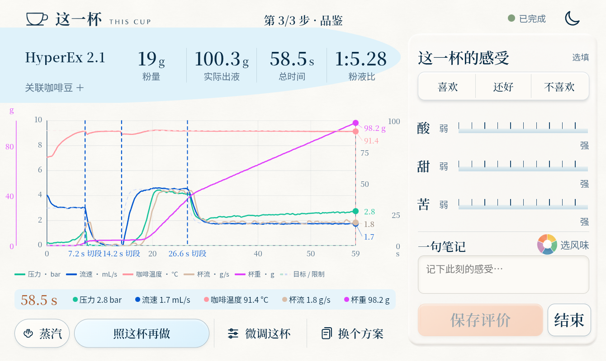
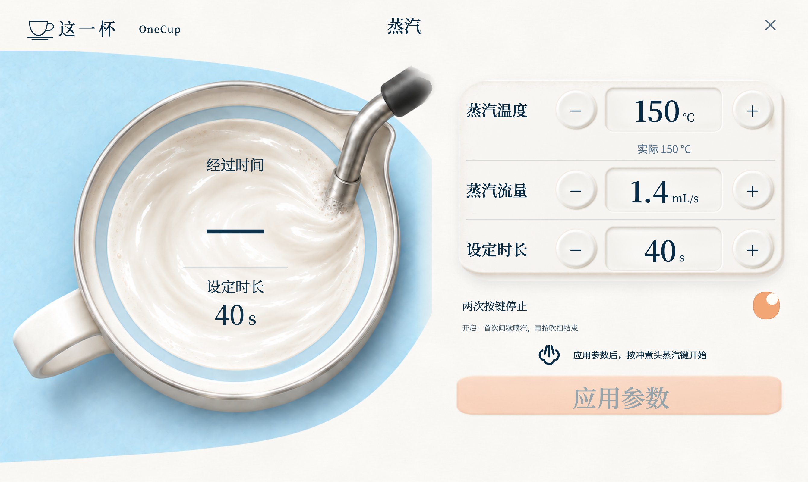
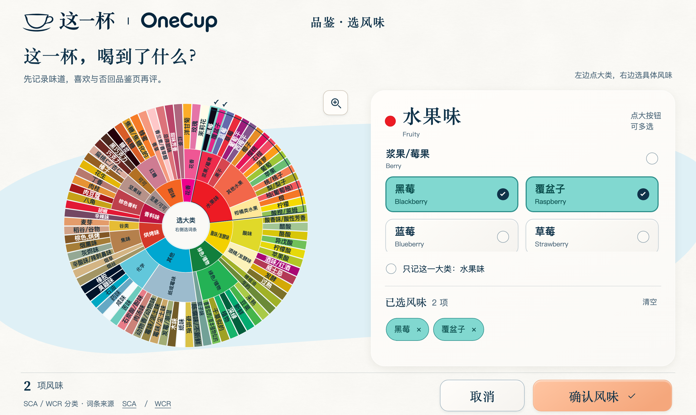
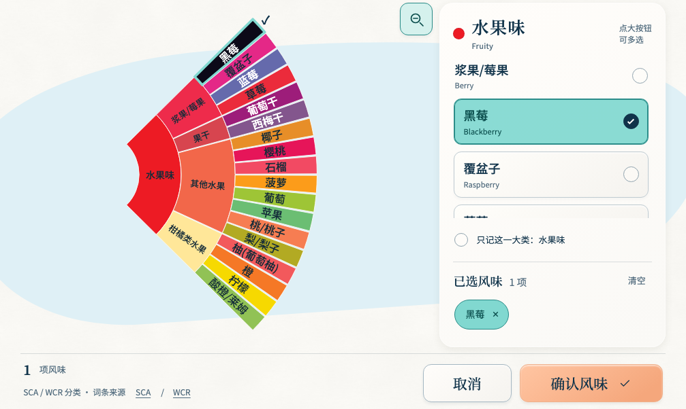

# 这一杯 · OneCup

一次，只做好一杯。

「这一杯 · OneCup」是一套给 Decaid 平板用的横屏皮肤。从选豆、调整配方，到看萃取、记口感，屏幕始终围绕正在做的这杯咖啡。

## 下载与安装

| 下载内容 | 国内下载 | GitHub 下载 | 安装说明 |
| --- | --- | --- | --- |
| **OneCup 皮肤 0.2.38** | [发行页](https://gitee.com/chowjw/OneCup/releases/tag/v0.2.38) · [皮肤 ZIP](https://gitee.com/chowjw/OneCup/releases/download/v0.2.38/onecup-0.2.38.zip) | [皮肤 ZIP](https://github.com/Chowjw-Vibecode/OneCup/releases/download/v0.2.38/onecup-0.2.38.zip) | [皮肤安装](#安装) |
| **小方 · CRYSTAL 磨豆机插件 0.2.0** | [发行页](https://gitee.com/chowjw/decaid-plugin-crystal-grinder/releases/tag/v0.2.0) · [插件 ZIP](https://gitee.com/chowjw/decaid-plugin-crystal-grinder/releases/download/v0.2.0/thiscup-crystal.reaplugin.zip) | [发行页](https://github.com/Chowjw-Vibecode/decaid-plugin-crystal-grinder/releases/tag/v0.2.0) · [插件 ZIP](https://github.com/Chowjw-Vibecode/decaid-plugin-crystal-grinder/releases/download/v0.2.0/thiscup-crystal.reaplugin.zip) | [插件安装与入口](https://github.com/Chowjw-Vibecode/decaid-plugin-crystal-grinder#下载与安装) |

## 设计思路

站在咖啡机前，每一步想知道的事都不一样。开始前，要确认这杯怎么做；出液时，抬眼就想知道流得快不快；喝过之后，才有理由决定下一杯要改什么。准备、萃取、品鉴三个页面就按这个顺序展开。

画面从一只白瓷杯开始。浅蓝衬出杯碟，暖白的纸纹延伸到参数面板。深色文字用来读数，橙色留给手边最重要的操作。到了萃取页，压力和流量沿用 Decent 曲线的配色，熟悉机器的人可以凭颜色辨认。

### 准备 · 确认这一杯怎么做

左边是杯子，右边把方案、咖啡豆、粉量、目标出液和水温放在一起。点方案名能看它怎样分段；配方合适，按冲煮头上的实体键就能开始。

想沿用方案，只改这一杯的用量或温度，可以点「调整这一杯」。粉量和目标出液并排，调整时能一起看粉液比。要找新方案，从「换方案 → 更多」进入官方或社区目录，预览后下载到本地。

### 萃取 · 抬眼看读数，低头看变化

三个指针给出当下的压力、进水流量和咖啡温度。下方曲线把这些读数放回时间轴。连上蓝牙秤后，还能对照杯重和杯流，看见机器开始进水之后，咖啡是什么时候流进杯里的。

### 品鉴 · 把味道记在曲线旁边

喝到偏酸或刚好合口时，左边就是这杯的完整曲线，点一下能查当时的读数。右边可以记酸、甜、苦和具体风味。喜欢就点「照这杯再做」，想试一点变化就点「微调这杯」。

## 豆仓与蒸汽

| 豆仓 | 蒸汽 |
| --- | --- |
|  |  |
| 咖啡豆可以直接称，也可以连袋称，再扣掉空袋重量。关联豆子后，每做完一杯，豆仓会扣除这杯的用豆量。 | 打奶前可以调整蒸汽温度、流量和时长。打奶时，奶缸上的计时和进度环方便随时查看。 |

以上为新版界面预览，使用示例数据；图片以两倍像素导出。

## 安装

1. 下载皮肤包 **onecup-0.2.38.zip**，保留 ZIP 格式，在 Decaid 的皮肤管理中安装并选用「这一杯 · OneCup」。
2. 使用蓝牙秤时，在准备页打开「蓝牙秤」，选择要连接的秤。连接成功后会记住主秤。
3. 需要联动小方或 Crystal 磨豆机时，请安装[独立磨豆机插件 0.2.0](https://github.com/Chowjw-Vibecode/decaid-plugin-crystal-grinder#下载与安装)。推荐 **Plugins → Plugin actions → Install plugin → GitHub Release**：Repository 填 `Chowjw-Vibecode/decaid-plugin-crystal-grinder`，Asset name 填 `thiscup-crystal.reaplugin.zip` 或留空，并开启 Decaid 自动检查更新。国内 ZIP 手装方式见插件说明；皮肤更新不替换控制器。

[本版更新说明](https://gitee.com/chowjw/OneCup/releases) · [皮肤源码](skin) · [磨豆机插件独立仓库](https://github.com/Chowjw-Vibecode/decaid-plugin-crystal-grinder)

## 0.2.38

- 修复风味轮点选后额外出现的矩形焦点框，保留蒂芙尼蓝扇区轮廓和外圈对勾。键盘操作仍以扇区虚线提示焦点。

## 0.2.37

- 修复研磨过程中状态通知导致的入口、标题及开始 / 停止按钮闪动；保留异常提示和停止能力。

## 0.2.36

- 设置开关明确显示「已开启 / 已关闭」，搭配滑动圆点与颜色。
- 更新配置显示当前皮肤版本。
- China 镜像默认开启，保留用户已保存的手动选择，失败时仍回退 GitHub。

## 0.2.35

- 英文名称统一为 OneCup，采用设计师提供的中英文一体透明标识，适配平板与桌面分辨率。
- 设置增加「China 镜像服务器」，开启后优先使用 Gitee，检查失败时回退 GitHub。国内与 GitHub 发布相同安装包。
- 准备页主操作字体与其他操作按钮统一；品鉴页短方案名与豆名不重叠。

## 0.2.33

- 自动更新改为每小时检查一次，已有六小时等待时间会缩短。
- 设置页增加「检查更新」，自动更新关闭时也能立即检查；安装和刷新仍等待空闲且没有未保存修改。

## 0.2.32

- 风味轮适配平板实际可用高度，底部按钮完整显示；放大镜按钮、双指缩放和拖动，已选扇区与标签使用蒂芙尼蓝，对勾位于外圈。
- 品鉴页修复字母下沿裁切；豆名限制在方案名栏内，最多两行、超出省略。利用内部空白加高坐标图。

## 0.2.31

修复官方方案与社区方案切换时字体瞬间缩小再恢复的问题。

## 0.2.30 更新

- 品鉴页接入完整风味轮，保留负面词。只用一个放大按钮：点过类别时展开该大类，未点目标时放大全图；直接点选，返回小图保留勾选。确认后仍通过“保存评价”保存，旧风味原值不改。
- 设置增加“自动更新皮肤”，默认关闭。开启后在原生 Decaid 本机、连接健康、空闲且无未保存修改时检查和安装新版。候选版跟随同一候选频道及较新的正式版，正式版不自动转入候选版；失败不盲目重复安装，读回版本后才等待安全刷新。
- 更新只替换本皮肤目录，不清空方案、豆仓、记录或偏好。Decaid 当前安装接口不是原子替换，复制失败可能需在 Decaid 里手动重装皮肤；软件模拟通过不能替代实际平板更新验收。

风味轮界面预览（1340 × 800 可用区域，两倍像素导出）：

改名保留原有皮肤身份和数据存储位置，以延续已保存的设置、豆仓及评价。

## 许可证

原创程序代码采用 [MIT 许可证](LICENSE)。第三方字体、资料和素材仍适用其原有许可和版权声明。
